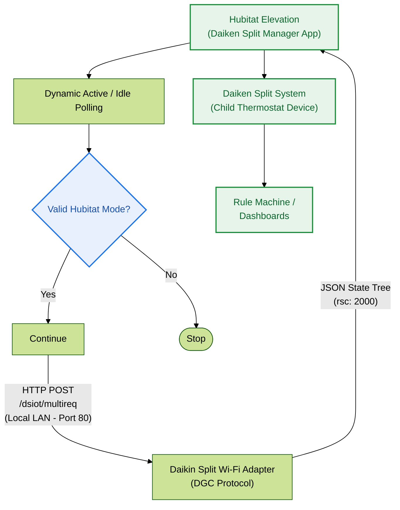
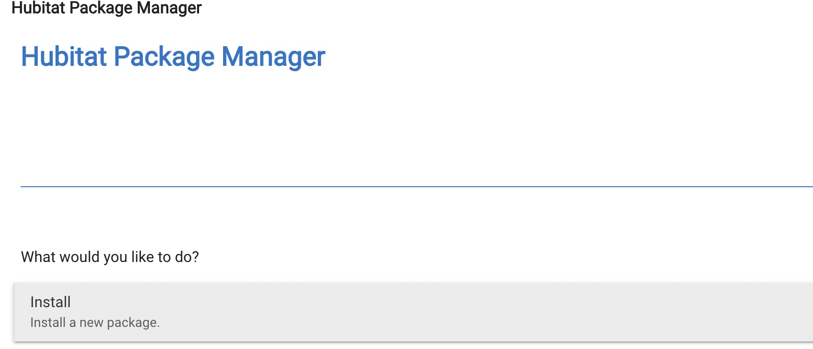
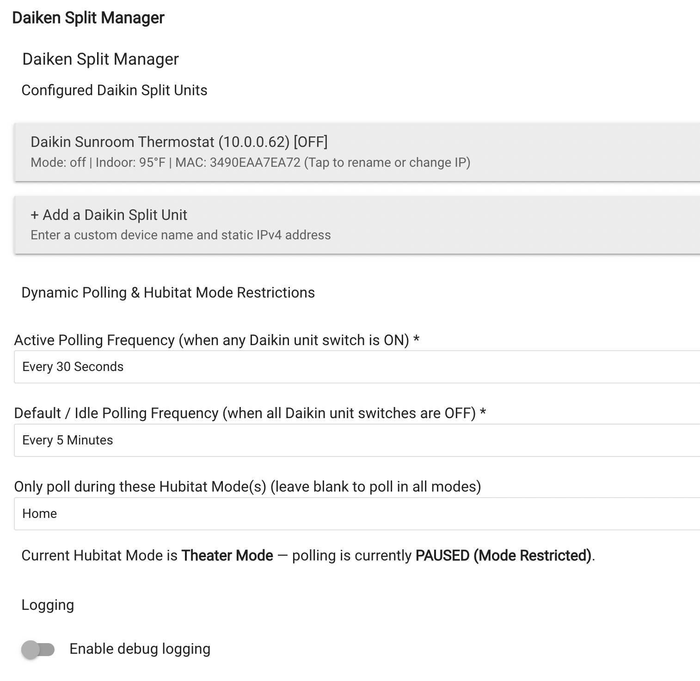
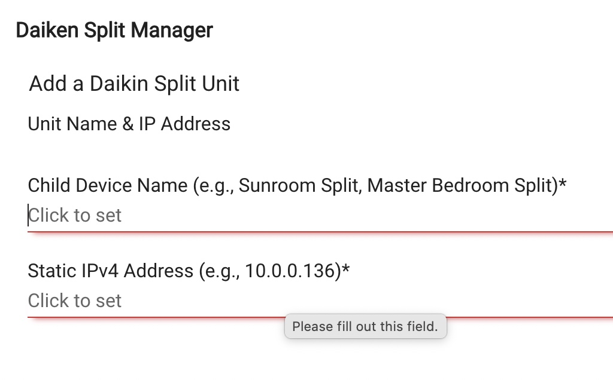
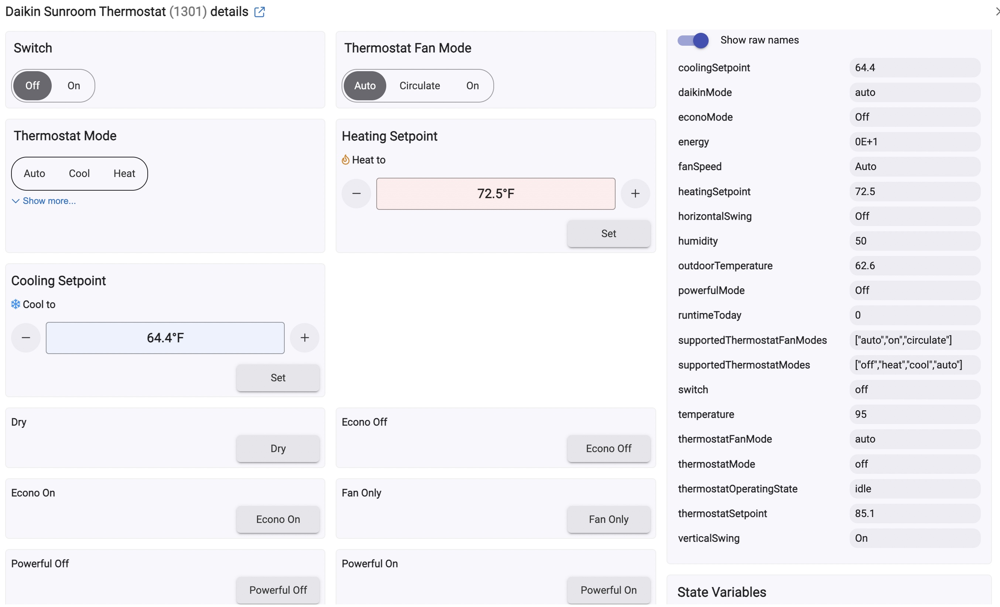

# Daiken Split Manager for Hubitat Elevation

[](https://hubitat.com/)
[](#1-verify-your-daikin-split-is-wi-fi-connected--compatible)
[](#2-installation-via-hubitat-package-manager-hpm)

**Daiken Split Manager** is a native Parent App and Child Device Driver suite for **Hubitat Elevation** that provides 100% local monitoring and control of Wi-Fi-enabled Daikin mini-split indoor units using Daikin's local `/dsiot/multireq` JSON API (`DGC` protocol)—with **no cloud dependency** and **no Home Assistant or MQTT middleware** required.

---

## Architecture Overview


---

## Key Features

* **100% Local LAN Control:** Communicates directly over port `80` via HTTP POST to `/dsiot/multireq`.
* **Multi-Unit Support & Custom Naming:** Manage multiple Daikin split indoor units under one parent app, with custom device names and easy IP/name editing.
* **Dynamic Active / Idle Polling:** Automatically polls faster (e.g., every 30 seconds) whenever **any** Daikin unit switch is `ON`, and drops back to a slower interval (e.g., every 5 minutes) when **all** units are `OFF`.
* **Hubitat Mode Restrictions:** Optionally restrict background polling to specific Hubitat Modes (such as `Home` or `Morning`) to minimize hub load when away or asleep.
* **Full Thermostat & Daikin-Specific Controls:**
  * Power (`on` / `off`), Thermostat Modes (`heat`, `cool`, `auto`, `dry`, `fanOnly`), and Heating/Cooling Setpoints (`°F` or `°C`).
  * Fan Speeds (`Auto`, `Quiet`, `Level 1` through `Level 5`).
  * **Vertical** and **Horizontal** louver swing toggles.
  * **Econo Mode** and **Powerful Mode** toggles.
  * Indoor temperature, outdoor ambient temperature, indoor relative humidity, daily energy consumption (`kWh`), and daily runtime (`min`).

---

## 1. Verify Your Daikin Split Is Wi-Fi Connected & Compatible

North American Daikin split systems sold over the last several years use one of three Wi-Fi architectures:
1. **Built-in / OEM Murata Wi-Fi Adapter (`protocol=DGC`):** Exposes a local JSON API at `/dsiot/multireq`. **Fully supported by this app.**
2. **Legacy BRP Adapters (`protocol=BRP`):** Uses `/aircon/get_control_info` text endpoints (not supported by this DSIOT driver).
3. **Locked Cloud-Only Firmware or Non-Wi-Fi Units:** Blocks local port `80` access or lacks a wireless interface module.

Follow these three steps from a macOS or Linux terminal (or Windows PowerShell) to confirm your unit is on your network and compatible:

### Step A: Find Your Daikin Unit's IP Address
1. Confirm your indoor unit is paired to your 2.4 GHz Wi-Fi network using the **Daikin Comfort Control** mobile app.
2. Open your router or DHCP server's **Active Leases / Attached Devices** table and look for a client with a **Murata Manufacturing** MAC address prefix (commonly starting with `34:90:EA`, `44:91:60`, `88:3F:4A`, or `D8:3A:DD`) or a hostname like `DaikinAP...`.
3. Note its IPv4 address (for example, `10.0.0.136`) and **assign a static DHCP reservation** so the IP never changes.

### Step B: Check `/common/basic_info`
Run the following `curl` command, replacing `10.0.0.136` with your unit's IP address:

```bash
curl -s "[http://10.0.0.136/common/basic_info](http://10.0.0.136/common/basic_info)"
```

**Compatible Output Example:**
```text
ret=OK,type=GPF,cdev=RA,protocol=DGC,reg=us,ver=3_2_0,rev=E3DFF9FE,comm_err=0,lpw_flag=0,adp_kind=4,mac=3490EAA7EA72,...
```
Look for **`ret=OK`** and **`protocol=DGC`**.

### Step C: Verify Local `/dsiot/multireq` Read Access
Test whether the local JSON status endpoint is open on port `80`:

```bash
curl -s -X POST "[http://10.0.0.136/dsiot/multireq](http://10.0.0.136/dsiot/multireq)" \
  -H "Content-Type: application/json" \
  -d '{"requests":[{"op":2,"to":"/dsiot/edge/adr_0100.dgc_status?filter=pv"}]}'
```

* **Compatible (`"rsc":2000`):** If the JSON response ends with `"rsc":2000`, your unit's local DSIOT API is active and ready for **Daiken Split Manager**.
* **Incompatible (`403 Forbidden`, `Page Not Found`, or `Connection refused`):** Your adapter firmware has disabled local HTTP access.

> **Important Tip:** Avoid accepting firmware updates inside the Daikin Comfort Control mobile app (or block WAN internet access for your Daikin IP on your router if you do not use Daikin's cloud app), as newer Daikin firmware revisions can restrict local `/dsiot/multireq` access.

---

## 2. Installation via Hubitat Package Manager (HPM)




### Option A: Install by Searching HPM (Recommended)
1. In your Hubitat web interface, open **Apps -> Hubitat Package Manager**.
2. Click **Install**, then choose **Search by Keywords**.
3. Enter **`Daiken Split Manager`** (or **`kurtsanders`**) and click **Next**.
4. Select **Daiken Split Manager** from the search results and click **Next** to automatically install both the Parent App (`Daiken Split Manager`) and the Child Driver (`Daiken Split System`).

### Option B: Install Directly via Manifest URL in HPM
If you are installing before the package appears in the HPM master repository index:
1. Open **Apps -> Hubitat Package Manager -> Install -> From a URL**.
2. Paste the raw GitHub URL in the field to `packageManifest.json`:
   ```text
   https://raw.githubusercontent.com/kurtsanders/Hubitat-Daiken-Split-Manager/main/packageManifest.json
   ```
3. Click **Next** and follow the prompts to complete installation.

### Option C: Manual Installation
1. **Install the App:** Go to **Apps Code -> New App**, paste the contents of [`apps/daiken-split-manager.groovy`](https://raw.githubusercontent.com/kurtsanders/Hubitat-Daiken-Split-Manager/main/apps/daiken-split-manager.groovy), and click **Save**.
2. **Install the Driver:** Go to **Drivers Code -> New Driver**, paste the contents of [`drivers/daiken-split-system.groovy`](https://raw.githubusercontent.com/kurtsanders/Hubitat-Daiken-Split-Manager/main/drivers/daiken-split-system.groovy), and click **Save**.

---

## 3. Application Setup & Configuration

1. In Hubitat, go to **Apps -> Add User App** and select **Daiken Split Manager**.
2. Click **+ Add a Daikin Split Unit**.

   

3. Enter a **Child Device Name** (for example, `Sunroom Split`) and the unit's static **IPv4 Address** (for example, `10.0.0.136`), then click **Next**.

   
4. The app will immediately probe `http://<ip>:80/dsiot/multireq` to verify `rsc: 2000` and create your child thermostat device. Click **Next** to return to the main page.

5. Configure your **Dynamic Polling & Hubitat Mode Restrictions**:
   * **Active Polling Frequency:** Select how often to poll when **any** Daikin unit switch is `ON` (default: `Every 30 Seconds`).
   * **Default / Idle Polling Frequency:** Select how often to poll when **all** Daikin unit switches are `OFF` (default: `Every 5 Minutes`).
   * **Hubitat Mode(s):** Optionally select one or more Hubitat Modes during which scheduled polling is allowed. Leave blank to poll in all modes.
6. Click **Done** to save settings and start polling.

*(To rename a unit or update its IP address later, open **Daiken Split Manager** and tap the configured unit under **Configured Daikin Split Units**.)*

---

## 4. Child Device Capabilities, Attributes & Commands



### Standard Capabilities
* `Thermostat`
* `Switch`
* `TemperatureMeasurement`
* `RelativeHumidityMeasurement`
* `EnergyMeter`
* `Refresh`

### Custom Attributes
| Attribute | Type | Description |
| :--- | :--- | :--- |
| `outdoorTemperature` | `number` | Outdoor condenser ambient temperature (`°F` or `°C`) |
| `daikinMode` | `string` | Raw Daikin mode (`heat`, `cool`, `auto`, `dry`, `fan_only`) |
| `fanSpeed` | `string` | Active fan speed (`Auto`, `Quiet`, `Level 1` – `Level 5`) |
| `verticalSwing` | `string` | Vertical louver oscillation (`On` / `Off`) |
| `horizontalSwing` | `string` | Horizontal louver oscillation (`On` / `Off`) |
| `econoMode` | `string` | Daikin Econo power-saving mode (`On` / `Off`) |
| `powerfulMode` | `string` | Daikin 20-minute Powerful boost mode (`On` / `Off`) |
| `runtimeToday` | `number` | Daily compressor/indoor runtime in minutes |

### Custom Commands
| Command | Parameters | Description |
| :--- | :--- | :--- |
| `setFanSpeed` | `Auto`, `Quiet`, `Level 1`–`Level 5` | Sets indoor blower speed for the active mode |
| `setVerticalSwing` | `On`, `Off` | Enables or disables vertical louver swing |
| `setHorizontalSwing` | `On`, `Off` | Enables or disables horizontal louver swing (if supported by indoor unit) |
| `setEconoMode` / `econoOn` / `econoOff` | `On`, `Off` | Toggles Daikin Econo current-limiting mode |
| `setPowerfulMode` / `powerfulOn` / `powerfulOff` | `On`, `Off` | Toggles Daikin Powerful boost mode |
| `dry` | None | Powers on the unit in Dehumidify (`dry`) mode |
| `fanOnly` | None | Powers on the unit in Fan-Only circulation mode |
